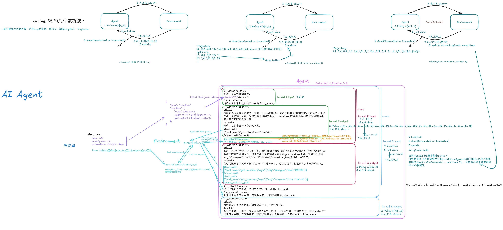

# ai agents notes

这本书是我的ai agents笔记，从2026年10月13日开始。我已经落地上海徐汇区（2026.10.13），也算是正式进组了。

在2022年末ChatGPT轰动世界后，大模型技术正式宣告新一轮科技革命的开始。而大模型要落地，靠的是ai agents。ai agents systems是以大模型为决策大脑的软件工程系统。

于是我们这本书站在前沿，系统阐释一下ai agents的底层理论和工程实践。

我们这本书理论和代码并重。讨论的ai agents是llm based ai agents，即基座模型为大语言模型。

本书适合对python语言或者go语言的基础语法比较熟悉的读者，且有深度学习、强化学习基础更好。深度学习的学习和论述可以见`dl.md`;强化学习的学习和论述可以见`rl.md`。

希望这本书对各大读者有帮助，欢迎各位读者提交PR、和我沟通等。

- 我的邮箱: zhouhy5523@gmail.com

---

后续我会录一期视频讲解这张图。敬请期待！

---

## 实验 42：AI Agents 的最小完整实现

本实验以 LLM 为决策核心，把 Agent Loop 拆解为消息上下文、工具调用、工具结果和后续推理，并分别使用 Go 与 Python 实现同一套运行时。

实验包含五个可运行的演示：

1. 单次天气工具调用，验证模型发起的调用能够真正执行并返回结果。
2. 先获取时间戳，再并行查询杭州、上海和北京天气，展示多轮、先串联后并联的工具编排。
3. 在相同工具编排中实时输出模型响应，展示流式 Agent Loop。
4. 使用滑动窗口保留系统提示和最近消息，并清理窗口开头孤立的工具结果。
5. 使用压缩记忆展示 80% 触发阈值、工具组安全裁剪、最近消息保护、摘要折叠、真实 token 用量触发、重试及失败降级。

代码：[Go 实现](code/ai-agents/go-framework/agent_runtime/) / [Python 实现](code/ai-agents/python-framework/)。
