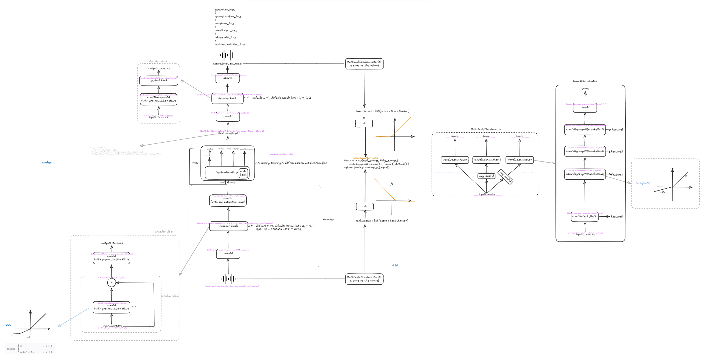

# audio deep learning notes

这本书是我的语音/音频深度学习笔记，从 2026 年 10 月开始，我刚开始语音 AI 方向的直博学习。

语音 AI 正在从一个个专用任务模型走向语音大模型。我想把语音大模型这条路系统地学一遍：从波形和 codec 到 audio language model，把每一步的"为什么"讲清楚。

本书数学基础和代码并重，但公式服务于理解，不追求堆推导。尤其重视**数据流和张量形状**：每个公式都要能对应到代码里的一个张量，每个模块都要说清它的输入是什么、输出是什么、梯度从哪走。

本书适合有一定深度学习基础、熟悉 Python，但还没有系统接触过语音AI、语音大模型的读者（深度学习部分可以先读 [dl.md](dl.md)）。希望各位读者读得顺利，欢迎提交 PR、和我沟通。

- 我的邮箱: zhouhy5523@gmail.com

---

## 一、neural audio codec

本书第一部分是 **neural audio codec（神经音频编解码器）**。它是阅读语音大模型论文的第一块基石,这些论文里的 related work 部分反复出现的 audio tokens、semantic/acoustic tokens、RVQ，底层都是这一套东西。

这一部分只解决一个问题：一段波形怎样变成一串整数（codes），又怎样从这串整数变回波形。

符号约定（初次可跳过，后续来查即可）：

$F$：latent 帧数。
- $D$：latent 维度；$Q$：RVQ 层数；$K$：每层码本的项数。
- $x$：原始波形；$z$：encoder 输出的连续 latent；$z_q$：量化后的 latent；$\hat x$：重建波形。
- $E\in\mathbb R^{K\times D}$：一个码本；$e_k$：码本的第 $k$ 项。

---

**为什么需要 codec？**

语音在计算机里就是一串振幅。采样率为 16000 Hz 的单声道音频，1 秒就是 16000 个浮点数，在 PyTorch 里形状是：

$$
x: [B, 1, T]
$$

第一维B是batch size，第二维是声道数，第三维T是1s中的采样点数，采样的指标是声音的振幅。

这串数字里没有音素、没有文字、没有 token。如果想让语言模型处理语音，直接拿波形有两个障碍：

1. **太长**。逐采样点自回归，1 秒就是 16000 步，序列长度不可接受。
2. **是连续值**。语言模型擅长预测离散 token（词表里的一个词），不擅长直接预测浮点振幅。

Codec 就是来解决这两件事的：先把波形压成低帧率的离散整数，语言模型只需要学这些整数；生成时再解码回波形。

Codec的训练可以使用GAN（生成对抗网络），具体逻辑见实验代码学习即可。

#### 实验 40：neural audio codec 的完整实现及训练(含GAN方法)
>
> `code/codec/`
> 
> 环境与全部使用步骤（uv 安装、四步训练/评估/编解码流程）见 [`code/codec/README.md`](code/codec/README.md)。

