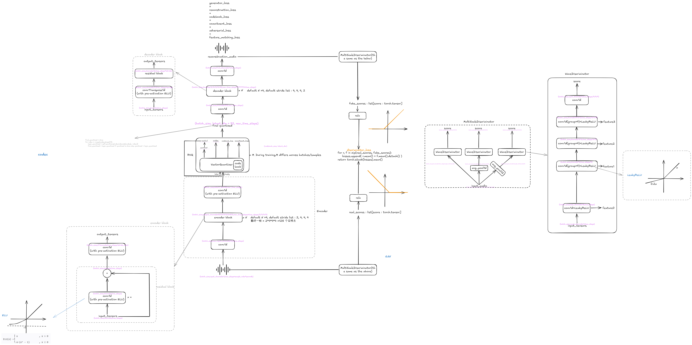
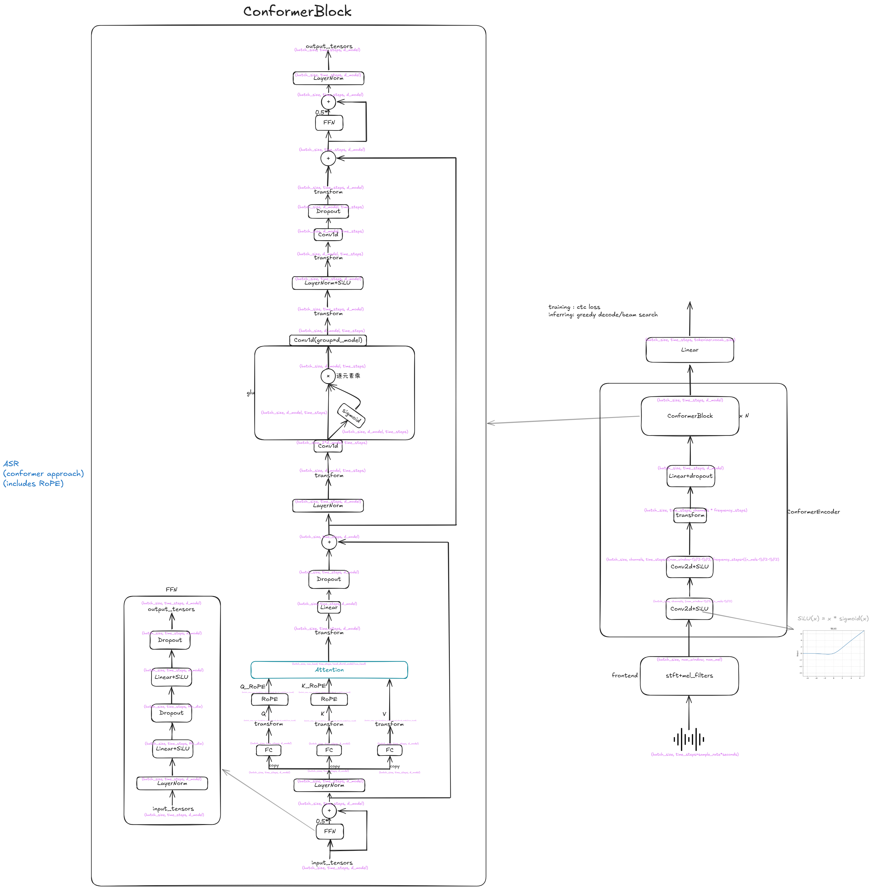
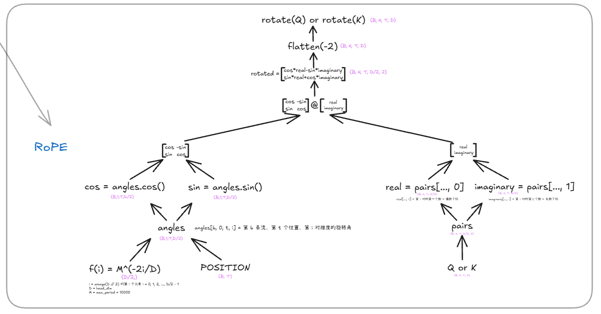
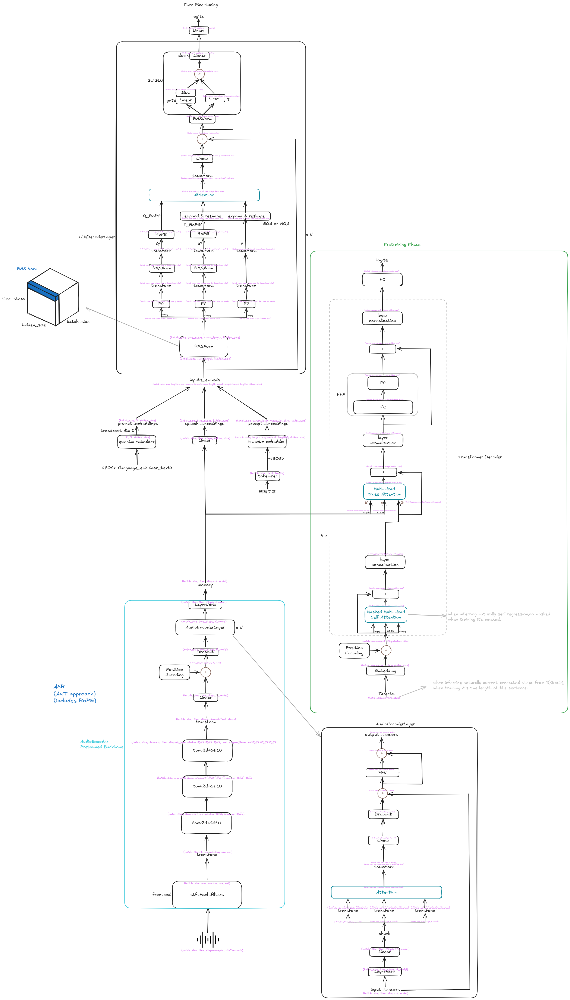
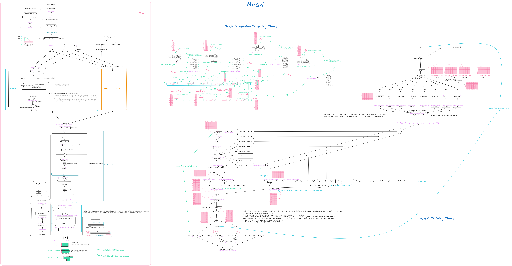
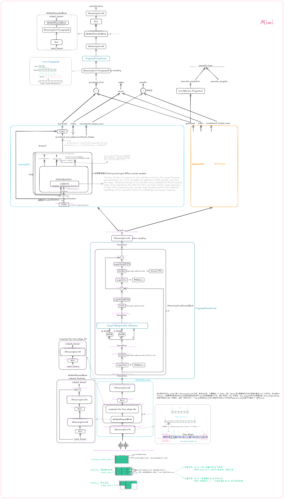
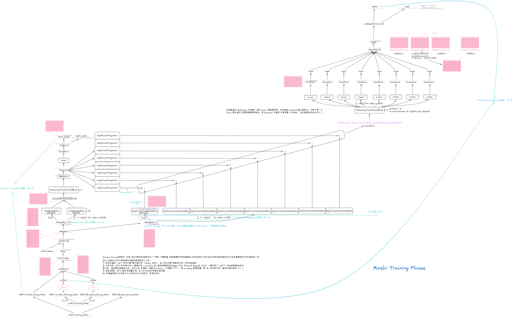
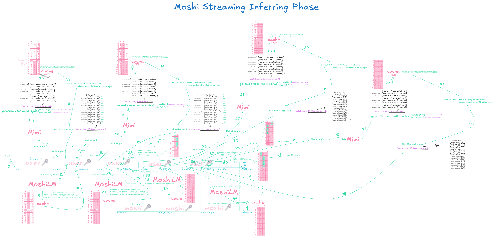
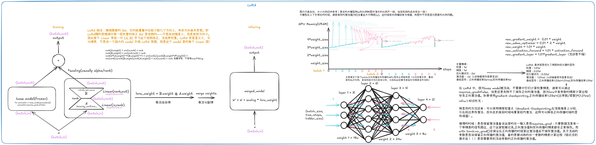

# audio deep learning notes

这本书是我的语音/音频深度学习笔记，从 2026 年 10 月开始，我刚开始语音 AI 方向的直博学习。

语音 AI 正在从一个个专用任务模型走向语音大模型。我想把语音AI、语音大模型这条路系统地学一遍：从波形和 codec 到 audio language model，把每一步的"为什么"讲清楚。

本书数学基础和代码并重，但公式服务于理解，不追求堆推导。尤其重视**数据流和张量形状**：每个公式都要能对应到代码里的一个张量，每个模块都要说清它的输入是什么、输出是什么、梯度从哪走。

本书适合有一定深度学习基础、熟悉 Python，但还没有系统接触过语音AI、语音大模型的读者（深度学习部分可以先读 [dl.md](dl.md)）。希望各位读者读得顺利，欢迎提交 PR、和我沟通。

- 我的邮箱: zhouhy5523@gmail.com

---

## 一、neural audio codec

本书第一部分是 **neural audio codec（神经音频编解码器）**。它是阅读语音大模型论文的第一块基石,这些论文里的 related work 部分反复出现的 audio tokens、semantic/acoustic tokens、RVQ，底层都是这一套东西。

这一部分只解决一个问题：一段波形怎样变成一串整数（codes），又怎样从这串整数变回波形。

符号约定（初次可跳过，后续来查即可）：

$F$：latent 帧数。
- $D$：latent 维度；$Q$：RVQ 层数；$K$：每层码本的项数。
- $x$：原始波形；$z$：encoder 输出的连续 latent；$z_q$：量化后的 latent；$\hat x$：重建波形。
- $E\in\mathbb R^{K\times D}$：一个码本；$e_k$：码本的第 $k$ 项。

---

**为什么需要 codec？**

语音在计算机里就是一串振幅。采样率为 16000 Hz 的单声道音频，1 秒就是 16000 个浮点数，在 PyTorch 里形状是：

$$
x: [B, 1, T]
$$

第一维B是batch size，第二维是声道数，第三维T是1s中的采样点数，采样的指标是声音的振幅。

这串数字里没有音素、没有文字、没有 token。如果想让语言模型处理语音，直接拿波形有两个障碍：

1. **太长**。逐采样点自回归，1 秒就是 16000 步，序列长度不可接受。
2. **是连续值**。语言模型擅长预测离散 token（词表里的一个词），不擅长直接预测浮点振幅。

Codec 就是来解决这两件事的：先把波形压成低帧率的离散整数，语言模型只需要学这些整数；生成时再解码回波形。

Codec的训练可以使用GAN（生成对抗网络），具体逻辑见实验代码学习即可。

#### 实验 40：neural audio codec 的完整实现及训练(含GAN方法)
>
> `code/codec/`
> 
> 环境与全部使用步骤（uv 安装、四步训练/评估/编解码流程）见 [`code/codec/README.md`](code/codec/README.md)。

---

## 二、automatic speech recognition (ASR)

Codec 的目标是重建声音，ASR 的目标则是把声音变成文字。输入波形长度是 $N$，输出文本长度是 $U$，二者不同且没有逐帧人工对齐：

$$
x:[B,N],\qquad y:[B,U]
$$

ASR 的核心问题不是简单地把 RNN 换成 Transformer，而是：**怎样对齐两条长度不同的序列，怎样用这个目标训练，又怎样在推理时得到文本。**

本部分并列实现两条现代路线，不把任何一条当成另一条的附属品。

### 1. 非自回归路线：Conformer + CTC (includes RoPE)

### 2. LLM 路线：AuT + projector + Qwen3-style LM (includes RoPE)

Qwen3-ASR 的代表性结构不是“音频直接塞进一个黑盒大模型”，而是多阶段数据流：

1. **AuT 预训练**：AuT encoder + Transformer decoder，以 AED 方式学习语音到文本。
2. **ASR SFT**：复用 AuT encoder，接 projector，把语音 embedding 放入 decoder-only LLM 的输入序列。
3. **生成**：LLM 逐 token 输出文本，用 KV cache 避免每个新 token 都重算整段历史。

教学版从零实现上述两条路线（但教学版不声称复现 Qwen3-ASR 的大规模能力（需要大规模的数据以及训练））。

#### 实验 41：Conformer-CTC 与 AuT/Qwen3-ASR 的完整实现
>
> `code/asr/`
>
> 两条路线的环境、合成/真实训练、验证集选模、独立转录和形状检查见 [`code/asr/README.md`](code/asr/README.md)。论文、仓库阅读顺序与许可证见 [`code/asr/REFERENCES.md`](code/asr/REFERENCES.md)。

---

## 三、full-duplex spoken dialogue: Moshi

Codec 解决波形与离散 audio tokens 的相互转换，ASR 解决语音到文本；Moshi 进一步研究**机器如何一边听、一边说**。它不先把用户语音强制转成文本，也不等待一个完整说话轮次结束，而是联合建模三条信息：Moshi 自己说出的文本、Moshi 的音频、用户的音频。

图中左侧是 Mimi 的编解码器，右侧是 Moshi 的流式推理（上）与训练阶段（下）；后面的图会分别放大这些部分。

这条路线需要同时理解：

1. **Mimi**：因果 SeaNet、瓶颈 Transformer、Split RVQ、语义蒸馏与流式编解码。
2. **RQ-Transformer**：Temporal 沿时间建模，Depth 沿同一帧的码本建模，避免把 17 条流全部摊平到过长的序列里。
3. **Inner Monologue**：用 PAD/EPAD 把较稀疏的文本 token 对齐到 12.5 Hz 音频帧，让文本成为当前帧音频生成的前缀。
4. **延迟与流式状态**：acoustic delay 给 Temporal Transformer 留出建模码本依赖的机会；卷积缓存、overlap-add 和 KV Cache 让逐帧计算与整段计算保持一致。
5. **训练与微调**：文本和音频分别计算带 mask 的交叉熵，语义码本加权；真实微调数据用左声道表示 Moshi、右声道表示用户，并支持全量微调与 LoRA。

编码器由因果 SeaNet、瓶颈 Transformer、2× 下采样和 Split RVQ 组成：语义 VQ 与声学 RVQ 并行量化后相加，解码器再把 8 条码本还原成波形。

17 条流先按 `delays` 逐行右移、头部填 initial token，再整段 teacher forcing：Temporal Transformer 预测文本，Depth Transformer 沿同一帧逐码本预测音频，输出按 delay 反移回帧号后与真值算加权交叉熵。

推理换成逐 tick 的环形 KV Cache：每个 tick 只喂一列，产出当前帧的文本、当前帧的语义和上一帧的声学。

LoRA 只训练旁挂的 A/B 两个低秩矩阵：前向是 `xW + scaling·xBA`，合并后 `W' = W + scaling·BA`，推理几乎没有额外开销；图中也对比了全量微调与 LoRA 的显存账本。

教学版保留上述算法结构，但默认缩小隐藏维、层数、词表与数据规模。合成实验只验证数据流、梯度和训练/推理闭环，不宣称复现 7B Moshi 的真实对话能力。

#### 实验 42：Mimi 与全双工 Moshi 的训练、推理和 LoRA/全量微调
>
> `code/full-duplex-chat/moshi/`
>
> 环境、合成/真实数据训练、官方权重加载、独立语音生成、源码阅读顺序与许可证见 [`code/full-duplex-chat/moshi/README.md`](code/full-duplex-chat/moshi/README.md)。
