# deep learning notes

这本书是我的深度学习笔记，从2026年9月4日开始，我刚刚结束保研，是准大四的状态。

深度学习改变了世界，整个人工智能的大厦建立在深度学习之上，于是我想在正式成为一名严格意义上的研究生之前，把深度学习的基础打扎实了，系统地学一遍。

我们这本书不会涉及到太多的传统机器学习算法，比如SVM,EM等算法，但是学习一些经典的传统机器学习算法是非常有必要的，我们会涉及到一些。

本书适合有一定机器学习或深度学习基础，且对python语法比较熟悉，但是又没有系统地学习和整理这些知识的读者。希望这本书对各大读者有帮助，欢迎各位提交PR、和我沟通等。

- 我的邮箱: zhouhy5523@gmail.com

为了方便起见，本书大写字母符号都代表矩阵，小写字母符号代表标量。

## 一、线性回归

机器学习的监督学习算法分为回归和分类问题。直观上理解：回归问题指的是，给你一个样本向量，预测值是连续的，分类问题指的是，给你一个样本向量，预测值是离散的。

回归问题定义：给定n * (m+1)的矩阵X,代表n个样本，m个特征的样本组成的矩阵；给定n * 1的矩阵Y，代表n个样本的标签组成的矩阵，该矩阵的取值是连续的。请学习X,Y中的规律（回归算法），使得给出一个新的样本x，能预测一个新的y使得和真实正确的y尽量接近。

线性回归是一种回归算法，且是最简单的回归算法。

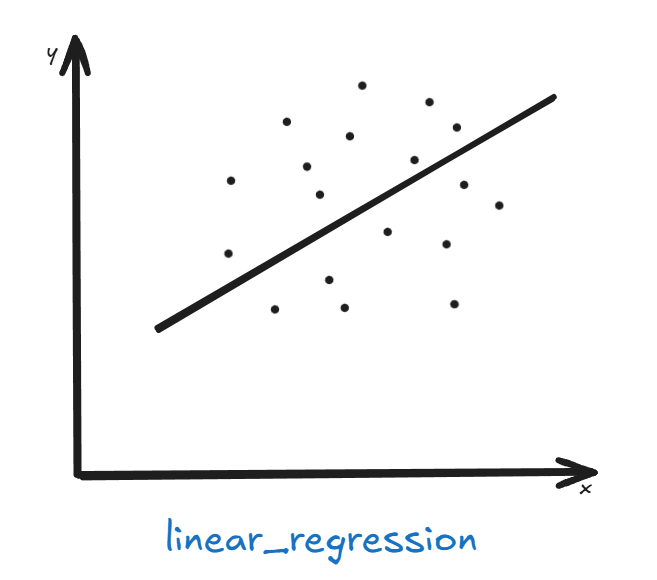

设最终学习到的模型权重W形状是(m+1) * 1,即最终的模型是：

$$
\hat{Y} = X * W 
$$

则损失函数为：

$$
L = \frac{1}{2n}||Y - \hat{Y}||^2=\frac{1}{2n}\sum_{i=0}^{n-1}(Y_i-\hat{Y_i})^2=\frac{1}{2n}\sum_{i=0}^{n-1}(Y_i-X_i*W)^2
$$

求导：

$$
\frac{\partial L}{\partial W_j} = -\frac{1}{n}\sum_{i=0}^{n-1}X_{ij} (Y_i-X_i*W)
$$

由梯度下降法：

BGD:

$$
W_j^{(t+1)}= W_j^{(t)} - \alpha\frac{\partial L}{\partial W_j}\Big|_{W^{(t)}} = W_j^{(t)} + \frac{\alpha}{n}\sum_{i=0}^{n-1}X_{ij} (Y_i-X_i*W^{(t)})
$$

SGD:

$$
W_j^{(t+1)}= W_j^{(t)} + \alpha X_{ij} (Y_i-X_i*W^{(t)})
$$

MBGD:

$$
W_j^{(t+1)}= W_j^{(t)} + \frac{\alpha}{|B|}\sum_{i \in B} X_{ij} (Y_i-X_i*W^{(t)}) \\
\text{where B is a random mini-batch from } [0,n)
$$

上标 $(t)$ 是迭代轮次，求和里的 $W^{(t)}$ 表示用当前这一轮的权重计算预测值。

#### 实验1：线性回归算法的具体实现(MBGD)
>
>`code/linear_regression/linreg_low_level.py`
>
>`code/linear_regression/linreg_high_level.py`

## 二、Softmax回归

Softmax回归是一种多类分类算法。

多类分类问题定义：给定n * (m+1)的矩阵X,代表n个样本，m个特征的样本组成的矩阵；给定n * 1的矩阵Y，代表n个样本的标签组成的矩阵，该矩阵的取值是离散多类的,一共k种。请学习X,Y中的规律（多类分类算法），使得给出一个新的样本x，预测该样本为y类别的概率尽可能大。

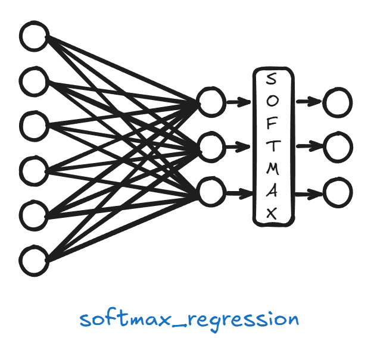

Softmax函数的定义是：

$$
Softmax(j) = \frac{exp(x_j)}{\sum_{i=0}^{k-1}exp(x_i)}
$$

设最终学习到的模型权重W形状是(m+1) * k,即最终的模型是：

$$
\hat{Y} = Softmax(X * W)
$$

Y hat 是一个n*k的矩阵，则损失函数为：

$$
L = -\frac{1}{n}\sum_{i=0}^{n-1} log \hat{Y_{ij}} \\
\text{j is the argmax index of  the one hot encoding of the }Y_i 
$$

按照梯度下降法更新参数W即可。

#### 实验2：Softmax回归算法的具体实现(MBGD)
>
>`code/softmax_regression/softmax_low_level.py`
>
>`code/softmax_regression/softmax_high_level.py`

## 三、多层感知机MLP

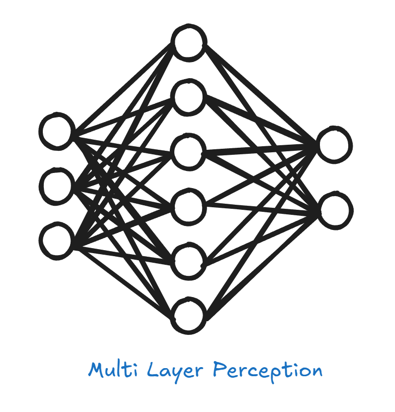

## 四、欠拟合、过拟合、VC维、正则项、权重衰退、丢弃法

当模型容量大于数据复杂度时，过拟合，当模型容量小于数据复杂度时，欠拟合。VC维指的是：对于一个分类模型，VC等于一个最大数据集的大小，不管如何给定标号，都存在一个模型来对它进行完美分类。

防止过拟合的一些手段，比如加正则项。通过限制参数值的选择范围来控制模型容量：

$$
min \space l(W,B) 
\\
subject \space to \space ||W||^2 ≤ \theta
$$

通常不限制B，小的θ意味着更强的正则项。

等价于:

$$
min \space l(W,B)+\frac{\lambda}{2}||W||^2
$$

这就是权重衰退，原因是：

$$
\frac{\partial}{\partial W} (l(W,B)+\frac{\lambda}{2}||W||^2) = \frac{\partial l(W,B)}{\partial W}+\lambda W
$$

时间t的更新你参数为：

$$
W_{t+1}=(1-η\lambda)W_t-η\frac{\partial l(W_t,B_t)}{\partial W_t}
$$

通常ηλ<1,在深度学习中称为权重衰退。

还有一种防止过拟合的方法，叫丢弃法(dropout)，丢弃法将一些输出项随机置0来控制模型的复杂度，要求保持无偏性：对X加入噪音得到X'，我们希望：

$$
E(X') = X
$$

丢弃法对每个元素进行如下扰动：

$$
x_i' = \begin{cases} 0,& \text{with probability p} \\ \frac{x_i}{1-p} , & \text{otherwise}\end{cases}
$$

dropout只在训练时对某些作用层发挥作用，推理时不发挥作用。

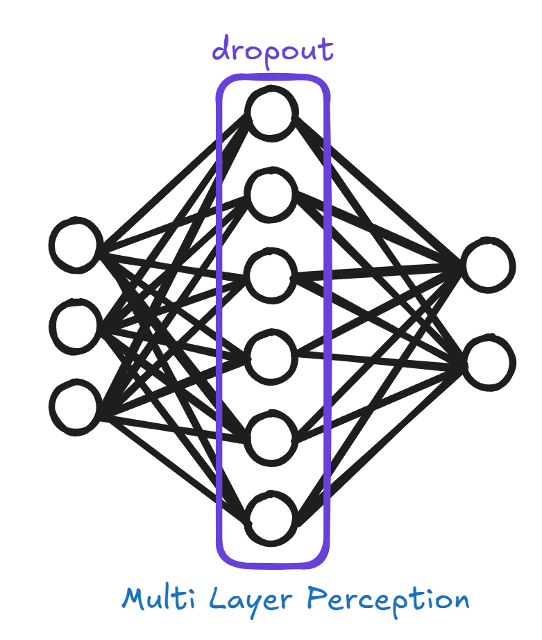

#### 实验3：Dropout的具体实现
>
>`code/dropout/dropout.py`

## 五、数值稳定性

当网络深度增加，由于链式法则，可能会出现两个问题：梯度爆炸和梯度消失。

对于梯度爆炸，值可能会超出值域，尤其是16位浮点数最为严重，对学习率也很敏感，太大会导致更大的梯度，太小训练又没有进展。

对于梯度消失，不管如何选择学习率，训练都没有进展。且对于底部层尤为严重，仅仅顶部层训练的较好，无法让神经网络更深。

目标：让梯度值在合理的范围内，例如[1e-6,1e3]，解决方法：

- 将乘法变加法
- 归一化，clip
- 合理的权重初始和激活函数

合理的权重初始方法是：将每层的输出和梯度都看做随机变量，让它们的均值和方差都保持一致。

正向传播,对于第t层的第i个神经元的输出：

$$
E[H_i^t] = 0 
\\
Var[H_i^t] = a
$$

反向传播，对于第t层的第i个神经元的梯度：

$$
E[\frac{\partial l}{\partial H_i^t}] =0 
\\
Var[\frac{\partial l}{\partial H_i^t}] =b 
$$

权重初始化是在合理值区间里随机初始参数。训练开始的时候更容易数值不稳定。使用N(0,0.01)来初始可能对小网络没问题，但不能保证深度神经网络。

对第t-1层的第j个神经元和第t层的第i个神经元之间的权重，假设有：

$$
1.W_{i,j}^t 独立同分布(i.i.d)，那么E[W_{i,j}^t]=0,Var[W_{i,j}^t]=\gamma_t
\\
2.H_j^{t-1}独立于W_{i,j}^t
$$

假设没有激活函数，

$$
H^t = W^tH^{t-1}
$$

则:

$$
E[H_i^t] = E[\sum_j W_{i,j}^tH_j^{t-1}] = \sum_j E[W_{i,j}^t]E[H_j^{t-1}] = 0
$$

正向方差：

$$
Var[H_i^t] = E[(H_i^t)^2]-E[H_i^t]^2 = E[(\sum_j W_{i,j}^tH_j^{t-1})^2] = E[\sum_j (W_{i,j}^t)^2(H_j^{t-1})^2+\sum_{j≠k}W_{i,j}^tW_{i,k}^tH_{j}^{t-1}H_{k}^{t-1}]=\sum_jE[(W_{i,j}^t)^2]E[(H_j^{t-1})^2]=\sum_j Var[W_{i,j}^t]Var[H_j^{t-1}]=n_{t-1}\gamma_t Var[H_j^{t-1}]
$$

由此可推出：

$$
n_{t-1}\gamma_t=1
$$

反向均值和方差：

$$
\frac{\partial l}{\partial H^{t-1}} = W^t\frac{\partial l}{\partial H^t}
$$

则：

$$
E[\frac{\partial l}{\partial H^{t-1}}] = 0 
\\
Var[\frac{\partial l}{\partial H^{t-1}}] = n_t\gamma_tVar[\frac{\partial l}{\partial H_j^t}]
$$

则：

$$
n_t\gamma_t = 1
$$

但是难以满足

$$
n_{t-1}\gamma_t=1 \text{ and } n_t\gamma_t = 1
$$

Xavier初始化使得

$$
\gamma_t(n_{t-1}+n_t)/2 =1
$$

则：

$$
\gamma_t = 2/(n_{t-1}+n_t)
$$

则可以是：

$$
N(0,\sqrt{2/(n_{t-1}+n_t)})
\\
U(-\sqrt{6/(n_{t-1}+n_t)},\sqrt{6/(n_{t-1}+n_t)})
$$

Xavier初始化策略有助于提升数值稳定性，适用于在 0 点附近近似恒等映射（f(0)=0 且 f'(0)=1）的激活函数，典型代表是 tanh。

## 六、卷积神经网络CNN

从全连接到卷积，需要先明白图片特征提取的一些原则：平移不变性和局部性。

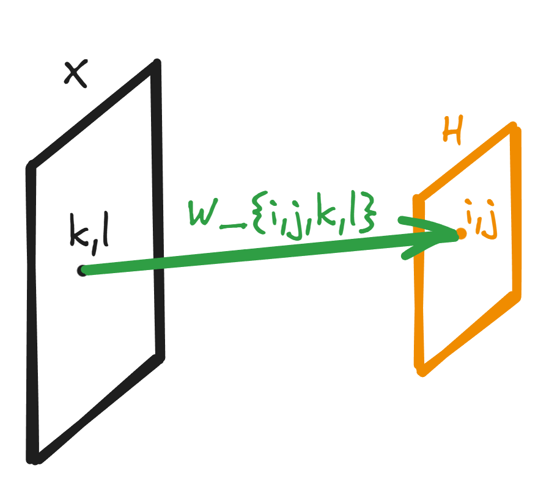

很容易有：

$$
H_{i,j} = \sum_{k,l} W_{i,j,k,l}*X_{k,l} + bias
$$

令 k = i + a, l = j + b,V是W的重新索引，

有：

$$
H_{i,j} = \sum_{a,b} V_{i,j,a,b}*X_{i+a,j+b} + bias
$$

由平移不变性（对一个局部图案：X 平移后，跟随图案的窗口内像素值不变；假设窗口在平移前后都完整；我们要求输出值也不变，只是位置跟着平移——要这对任意输入成立，权重必须不随位置变化），得：

$$
V_{i,j,a,b} = V_{a,b}
$$

推导里求和默认窗口总是完整的。真实场景中图像边缘处窗口可能缺了一块，实际做法（补零 padding）意味着边缘位置的"相对结构"被人为改了——严格来说补零会破坏完美的平移等变性，只是实践中影响小，大家接受了。想让等变性严格成立得用循环 padding（把图像当环面）。   

由局部性，得：

$$
H_{i,j} = \sum_{a=-\Delta}^{\Delta} \sum_{b=-\Delta}^{\Delta} V_{a,b}*X_{i+a,j+b} + bias
$$

这其实严格意义上来说，是交叉相关，不是严格意义上的数学卷积。但由于核是学习出来的，翻转与否不影响表达能力，深度学习框架实现的其实都是交叉相关。

#### 实验4：交叉相关的具体实现
>
>`code/cnn/cross_correlation.py`

如果考虑填充和步幅，则输出形状是：

$$
\lfloor (n_h-k_h+p_h+s_h)/s_h \rfloor × \lfloor (n_w-k_w+p_w+s_w)/s_w \rfloor
$$

注意这里的 $p_h$ 是两侧填充的**总行数**（大约一半在顶部、一半在底部），对应 PyTorch 里 `padding` 参数（单侧）的 2 倍。用 PyTorch 的单侧记法 $P$ 写就是 $\lfloor{}(n+2P-K)/S{}\rfloor{}+{}1$ ，两者等价，不要混用。

#### 实验5：填充和步幅的具体实现
>
>`code/cnn/padding_and_stride.py`

如果再考虑多输入通道:

$$
X : c_i × n_h × n_w \\
W : c_i × k_h × k_w \\
b : \text{scalar} \\
Y ：m_h × m_w \\
Y = \sum_{i=1}^{c_i} (X_{i,,} ※ W_{i,,}) + b \\
\text{where ※ is the convolution}
$$

如果再考虑多输出通道：

$$
X : c_i × n_h × n_w \\
W : c_o × c_i × k_h × k_w \\
b : c_o \\
Y ：c_o × m_h × m_w \\
Y_{j,,} = \sum_{i=1}^{c_i} (X_{i,,} ※ W_{j,i,,}) + b_j \\
\text{where ※ is the convolution, } j = 1, \dots, c_o
$$

偏置的维度是 $c_o$ ——每个输出通道一个标量偏置 $b_j$ ，广播加到该通道整个 $m_h{}×{}m_w$ 的输出上。单输出通道时偏置就退化成一个标量 $b$ 。

每个输出通道可以识别特定模式，输入通道核识别并组合输入中的模式。每个输入通道有独立的二维卷积核，每个输出通道有独立的三维卷积核。

---

1×1的卷积层的本质：它不识别空间模式，只是融合通道。

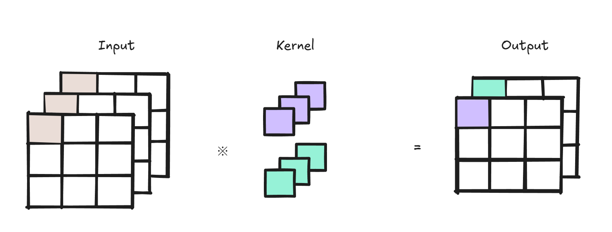

等价于：

$$
(n_h×n_w,c_i)为输入的，权重参数为(c_o,c_i)的Linear(c_i,c_o)层
$$

#### 实验6：1x1卷积的具体实现以及和全连接层等价的验证
>
>`code/cnn/one_multiply_one_convolution.py`

---

计算复杂度的计算：

一个输入通道对应一个二维卷积核，单次卷积操作计算量级别为

$$
k_h × k_w
$$

多个输入通道对应一个输出通道，对应多个二维卷积核（整体是一个三维卷积核），则单次卷积操作计算量级别为

$$
c_i × k_h × k_w
$$

每个输出通道都有一个三维卷积核，则多个输出通道的单次卷积操作计算量级别扩张到：

$$
c_o × c_i × k_h × k_w
$$

一共进行了

$$
m_h × m_w
$$

次卷积操作，所以综上，总的乘法计算量级别为：

$$
c_o × c_i × k_h × k_w × m_h × m_w
$$

如果考虑加法，

**第一部分**：注意到涉及到bias的加法是在做完卷积之后进行加bias的时候发生的，一次卷积操作且一个输出通道对应一次。现在我们进行了

$$
m_h × m_w
$$

次卷积操作，

$$
c_o
$$

个输出通道，所以涉及到bias的加法次数应该是:

$$
m_h × m_w × c_o
$$

**第二部分**：加法还有一种，多个输入通道和某个三维卷积核里的自己的一个二维卷积核卷积计算后，还应该做加和，合并成一个输出通道。一个输出通道即为:

$$
(c_i-1) × m_h × m_w
$$

次，一共又有

$$
c_o
$$

个三维卷积核（或者叫输出通道），则次数是：

$$
c_o ×(c_i-1)× m_h × m_w
$$

次。

**第三部分**：加法还有一种，单次二维卷积内部的加法，单次二维卷积是

$$
k_h × k_w -1
$$

次加法，一共进行了

$$
c_o × m_h × m_w
$$

次三维卷积操作，换算成二维是

$$
c_i × c_o × m_h × m_w
$$

次，所以这部分加法的计算量为：

$$
c_i ×c_o × m_h × m_w × (k_h × k_w -1)
$$

考虑所有运算，单层卷积层的计算量为：

$$
c_o × c_i × k_h × k_w × m_h × m_w + m_h × m_w × c_o + c_o ×(c_i-1)× m_h × m_w + c_i ×c_o × m_h × m_w × (k_h × k_w -1) = 2 × c_o × c_i × k_h × k_w × m_h × m_w
$$

综上，单层卷积层的计算级别是:

$$
O(c_o × c_i × k_h × k_w × m_h × m_w)
$$

#### 实验7：多输入通道和多输出通道的具体实现
>
>`code/cnn/multi_input_and_output_channels.py`

池化和卷积是两种不一样的操作，池化层虽然和卷积层类似，都具有填充和步幅，但是池化层没有可学习的参数。在每个输入通道应用池化层以获得相应的输出通道，池化层的输出通道数一定等于输入通道数。池化层可以缓解卷积层对位置的敏感性。

池化层有两种：最大池化层和平均池化层。

#### 实验8：池化层的具体实现
>
>`code/cnn/polling.py`

来看几个出名的卷积神经网络吧！

LeNet:

#### 实验9：LeNet的具体实现
>
>`code/cnn/lenet.py`

AlexNet:

#### 实验10：AlexNet的具体实现
>
>`code/cnn/alexnet.py`

VGG:

#### 实验11：VGG的具体实现
>
>`code/cnn/vgg.py`

NiN:

#### 实验12：NiN的具体实现
>
>`code/cnn/nin.py`

GoogLeNet:

#### 实验13：GoogLeNet的具体实现
>
>`code/cnn/googlenet.py`

## 七、批量归一化Batch Normalization

为了加速学习，我们可以计算小批量里面特征维度的（全连接层是特征维度，卷积层是通道维度）均值和方差：

$$
\mu_B = \frac{1}{|B|}\sum_{i∈B} x_i \text{ and } \sigma_B^2 = \frac{1}{|B|}\sum_{i∈B} (x_i-\mu_B)^2 + \epsilon
$$

然后再做额外的调整（可学习的参数γ和β）：

$$
x_{i+1} = \gamma \frac{x_i-\mu_B}{\sigma_B} + \beta
$$

批量归一化层的作用位置是：

1.全连接层和卷积层的输出后，激活函数前
2.全连接层和卷积层输入前

对全连接层，作用在特征维，对卷积层，作用在通道维。

最初该方法的论文是用它来减少内部协变量转移，但后续有论文指出他可能就是通过在每个小批量里加入噪音来控制模型复杂度，因此没必要和dropout混合使用。

该方法固定一小批量中的均值和方差，然后学习出适合的偏移和缩放，可以加速收敛速度，但一般不改变模型的精度。

#### 实验14：Batch Normalization的具体实现
>
>`code/batch_normalization/batch_normalization_low_level.py`
>`code/batch_normalization/batch_normalization_high_level.py`

## 八、ResNet

y = f(x) + x

使用这个可以稳定训练出超级深的网络，原因：

$$
y = f(x) \\
w = w - \alpha \frac{\partial y}{\partial w}
$$

$$
y' = g(f(x)) \\
\frac{\partial y'}{\partial w} = \frac{\partial y'}{\partial y} \frac{\partial y}{\partial w} \\
\text{often the }\frac{\partial y'}{\partial y} \text{ is very small}
$$

若

$$
y'' = f(x) + g(f(x)) = y + y' \\
\frac{\partial y''}{\partial w} = \frac{\partial y}{\partial w} +\frac{\partial y'}{\partial w} = (1+ \frac{\partial y'}{\partial y} )\frac{\partial y}{\partial w}
\\
\text{often the 1+}\frac{\partial y'}{\partial y} \text{ is stable enough}
$$

#### 实验15：ResNet的具体实现
>
>`code/resnet/resnet.py`

## 九、数据并行、模型并行、多GPU训练

数据并行指的是：将小批量分成n块，每个GPU拿到完整参数计算一块数据的梯度。通常性能更好。

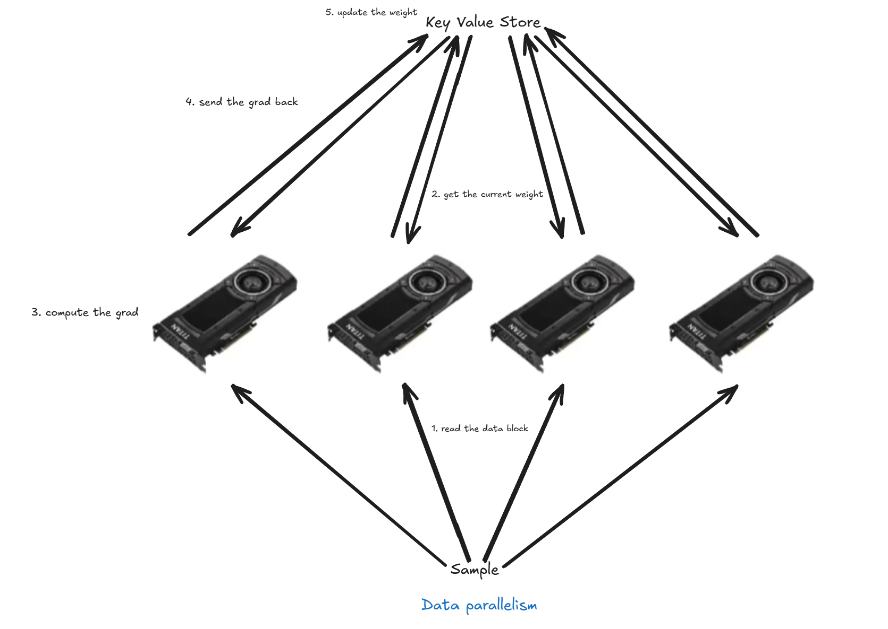

当一个模型能用单卡计算时，通常使用数据并行拓展到多卡上。

#### 实验16：数据并行的具体实现
>
>`code/multi_gpu_training/multi_gpu_training_low_level.py`
>
>`code/multi_gpu_training/multi_gpu_training_high_level.py`

模型并行：将模型分成n块，每个GPU拿到一块模型计算它的前向和方向结果。通常用于模型大到单GPU放不下。一般用在超大模型上。

## 十、序列模型和语言模型概述

音乐、语言、文本和视频都是连续的，即在时间t观察到 $x_t$ ，那么得到T个不独立的随机变量:

$$
(x_1,...,x_T) 
$$

服从p(**x**)。

使用条件概率展开

$$
p(\textbf{x}) = p(x_1)p(x2|x1)p(x3|x1,x2)...p(x_T)(x_1,...,x_{T-1})
$$

也可以这么展开(但物理上不一定可行)：

$$
p(\textbf{x}) = p(x_T)p(x_{T-1}|x_T)p(x_{T-2}|x_{T-1},x_T)...p(x_1|x_2,...,x_T)
$$

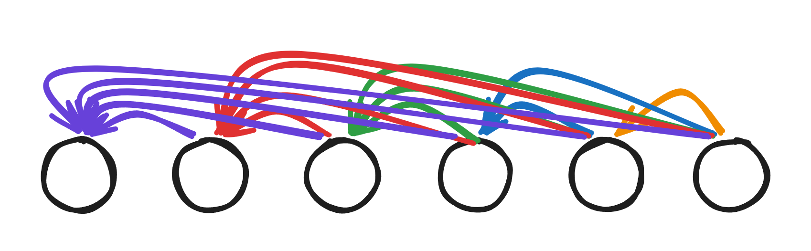

序列模型即可这样认为：

$$
p(x_t|x_1,...,x_{t-1}) = p(x_t|f(x_1,..,x_{t-1}))
\\
\text{f是对见过的数据建模，也称自回归模型}
$$

特殊的序列模型有：

1.马尔科夫假设下的马尔科夫序列模型：

假设当前数据只跟τ个过去数据点相关，即：

$$
p(x_t|x_1,...,x_{t-1}) = p(x_t|x_{t-\tau},...,x_{t-1}) = p(x_t|f(x_{t-\tau},...,x_{t-1}))
$$

2.潜变量模型：引入潜变量 $h_t$ 来表示过去信息:

$$
h_t = f(x_1,...,x_{t-1})
$$

这样就有：

$$
x_t = p(x_t|h_t,x_{t-1})
$$

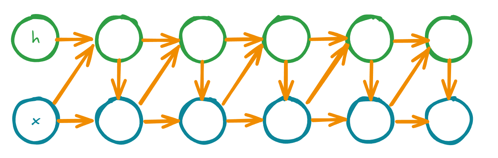

#### 实验17：序列模型的具体实现
>
>`code/nlp/sequence_model.py`

在了解语言模型前，先学会文本预处理：

#### 实验18：文本预处理的具体实现
>
>`code/nlp/text_pre_process.py`

给定文本序列

$$
x_1,...,x_T
$$

语言模型的目标是估计联合概率:

$$
p(x_1,...,x_T)
$$

它的应用包括：

- 做预训练模型
- 生成本文，给定前面几个词，不断使用条件概率自回归生成后续文本
- 判断多个序列中哪个更常见

等等。

使用计数来建模，假设序列长度为2，我们预测:

$$
p(x,x') = p(x)p(x'|x) = \frac{n(x)}{n} \frac{n(x,x')}{n(x)}
$$

这次n是总词数(len(corpus)),n(x)和n(x,x')是单个单词和连续单词对的出现次数。

很容易拓展到长为3的情况：

$$
p(x,x',x'') = p(x)p(x'|x)p(x''|x,x') =p(x)p(x'|x)p(x''|x,x') =\frac{n(x)}{n} \frac{n(x,x')}{n(x)} \frac{n(x,x',x'')}{n(x,x')}
$$

不过问题是，当序列很长时，因为文本量不够大，很可能经常

$$
n(x_1,...,x_T) ≤ 1
$$

我们可以使用马尔科夫假设缓解这个问题：

一元语法是假设 tau = 0,即：

$$
p(x_1,x_2,x_3,x_4) = p(x_1)p(x_2)p(x_3)p(x_4)
= \frac{n(x_1)}{n}\frac{n(x_2)}{n}\frac{n(x_3)}{n}\frac{n(x_4)}{n}
$$

二元语法是假设 tau = 1,即：

$$
p(x_1,x_2,x_3,x_4) = p(x_1)p(x_2|x_1)p(x_3|x_2)p(x_4|x_3) = \frac{n(x_1)}{n}\frac{n(x_1,x_2)}{n(x_1)}\frac{n(x_2,x_3)}{n(x_2)}\frac{n(x_3,x_4)}{n(x_3)}
$$

三元语法是假设 tau = 2,即:

$$
p(x_1,x_2,x_3,x_4) = p(x_1)p(x_2|x_1)p(x_3|x_1,x_2)p(x_4|x_2,x_3)
$$

齐普夫定律：少数词极高频，绝大多数词极罕见（长尾）。

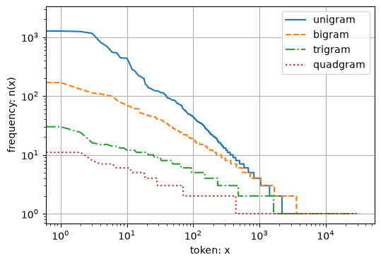

#### 实验19：齐普夫定律的验证
>
>`code/nlp/zipf_law_loglog.py`

#### 实验20：文本序列数据的准备
>
>`code/nlp/seqdataloader.py`

## 十一、循环神经网络RNN

循环神经网络的输出取决于当下输入和前一时间的隐变量。

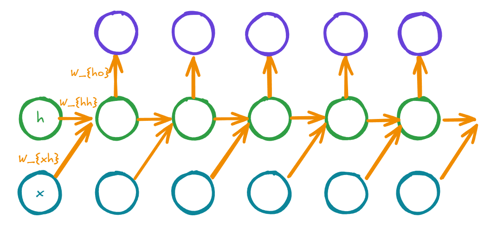

- $H_t$ 或 $H_{t-1}$ 为形状为(batch_size,hidden_size)的张量，代表状态。

- $W_{hh}$ 为形状为(hidden_size,hidden_size)的张量。

- X为形状为(num_steps,batch_size,vocab_size)的张量。 $X_t$ 为形状为(batch_size,vocab_size)的张量。

- $W_{xh}$ 为形状为(vocab_size,hidden_size)的张量。

- $B_h$ 为形状为(1,hidden_size)的张量，公式里通过广播和其他张量相加。

- $W_{ho}$ 为形状为(hidden_size,vocab_size)的张量。

- $B_o$ 为形状为(1,vocab_size)的张量，公式里通过广播和其他张量相加。

则rnn的公式是：

更新隐藏状态：

$$
H_t = f(H_{t-1}W_{hh}+X_tW_{xh}+B_h)
$$

其中f函数常见为tanh。

输出：

$$
O_t = H_tW_{ho}+B_o
$$

$O_t$ 为 logits，经 softmax 后才是概率；实际计算中 softmax并入交叉熵损失。

困惑度(perplexity)是衡量一个语言模型的好坏的指标。1表示完美，无穷大是最差情况。

有平均交叉熵：

$$
\pi = \frac{1}{n}\sum_{t=1}^{n}-logp(x_t|x_{t-1},...) 
$$

p是语言模型的预测概率， $x_t$ 是真实词。

有困惑度：

$$
perplexity = exp(\pi)
$$

梯度裁剪：迭代过程中计算T个时间步上的梯度，在反向传播过程中产生长度为O(T)的矩阵乘法链，导致数值不稳定，梯度裁剪能有效预防梯度爆炸，如果梯度长度超过θ,那么缩放为长度θ：

$$
g ← min(1,\frac{\theta}{||g||})\mathbf{g}
$$

应用到语言模型中时，循环神经网络根据当前词预测下一时刻词。

#### 实验21：rnn的具体实现
>
>`code/nlp/rnn_low_level.py`
>
>`code/nlp/rnn_high_level.py`

## 十二、门控循环单元GRU

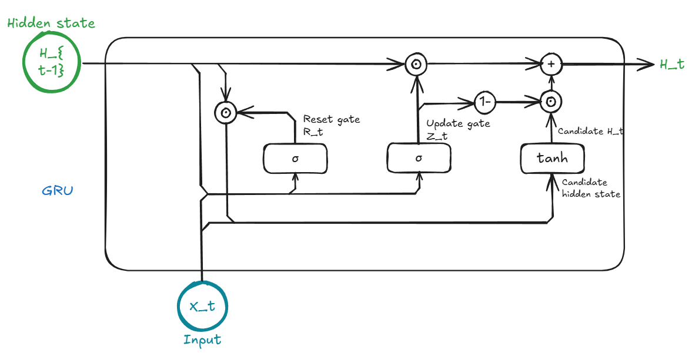

我们发现一个徐丽不是每个观测值都是同等重要的，想只记住相关的观察需要：能关注的机制（更新门）和能遗忘的机制（重置门）。

- $W_{xr}$ 或 $W_{xz}$ 或 $W_{xh}$ 为形状为(vocab_size,hidden_size)的张量。

- $W_{hr}$ 或 $W_{hz}$ 或 $W_{hh}$ 为形状为(hidden_size,hidden_size)的张量。

- $B_r$ 或 $B_z$ 或 $B_h$ 为形状为(1,hidden_size)的张量，公式里通过广播和其他张量相加。

- X为形状为(num_steps,batch_size,vocab_size)的张量。 $X_t$ 为形状为(batch_size,vocab_size)的张量。

- $H_t$ 或 $H_{t-1}$ 或 $R_t$ 或 $Z_t$ 或 $\tilde{H_t}$ 为形状为(batch_size,hidden_size)的张量。

我们有GRU:

$$
R_t = \sigma(X_tW_{xr}+H_{t-1}W_{hr}+B_r) \\
Z_t = \sigma(X_tW_{xz}+H_{t-1}W_{hz}+B_z) \\
\tilde{H_t} = tanh(X_tW_{xh}+(R_t \odot H_{t-1})W_{hh}+B_h) \\
H_t = Z_t \odot H_{t-1} + (1-Z_t) \odot \tilde{H_t}
$$

当Z=0，R=1，等价于RNN。

这里公式忽略了输出的全连接层。

#### 实验22：gru的具体实现
>
>`code/nlp/gru_low_level.py`
>
>`code/nlp/gru_high_level.py`

## 十三、长短期记忆网络LSTM

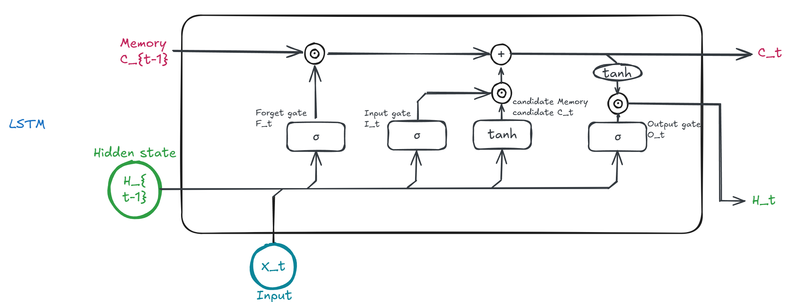

我们有LSTM:

$$
I_t = \sigma(X_tW_{xi}+H_{t-1}W_{hi}+B_i) \\
F_t = \sigma(X_tW_{xf}+H_{t-1}W_{hf}+B_f) \\
O_t = \sigma(X_tW_{xo}+H_{t-1}W_{ho}+B_o) \\
\tilde{C_t} = tanh(X_tW_{xc}+H_{t-1}W_{hc}+B_c) \\
C_t = F_t \odot C_{t-1} + I_t \odot \tilde{C_t} \\
H_t = O_t \odot tanh(C_t)
$$

#### 实验23：lstm的具体实现
>
>`code/nlp/lstm.py`

关于深度循环神经网络，有：

$$
H_t^{(1)} = f^{(1)}(H_{t-1}^{(1)},X_t^{(0)}) \\
H_t^{(2)} = f^{(2)}(H_{t-1}^{(2)},H_t^{(1)})\\
...\\
H_t^{(j)} = f^{(j)}(H_{t-1}^{(j)},H_t^{(j-1)})\\
O_t = g(H_t^{(L)})
$$

深度循环神经网络使用多个隐藏层来获得更多的非线性性。

#### 实验24：深度循环神经网络的具体实现
>
>`code/nlp/deep_lstm.py`

关于双向循环神经网络，有：

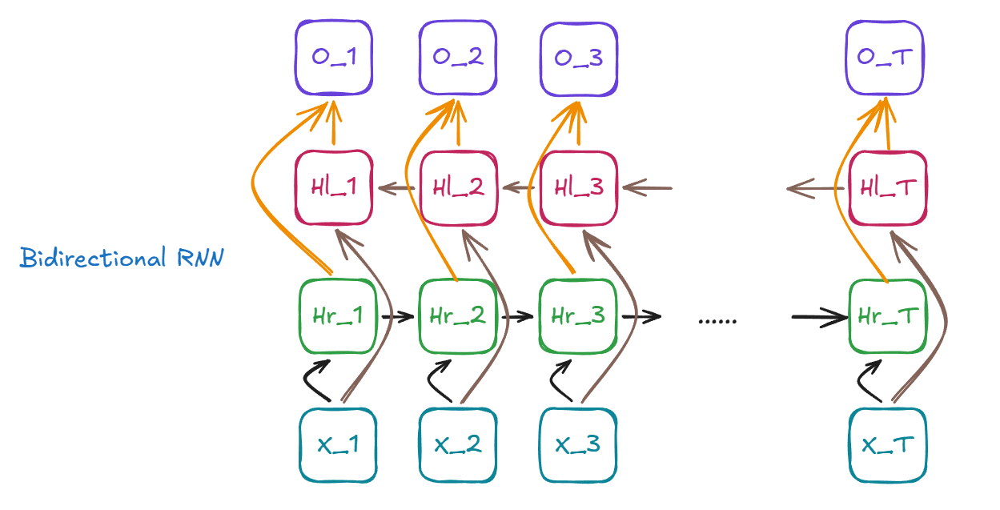

$$
\overrightarrow{H_t}= f(X_tW_{xh}^{(f)}+\overrightarrow{H}_{t-1}W_{hh}^{(f)}+B_h^{(f)}) \\
\overleftarrow{H_t}= f(X_tW_{xh}^{(b)}+\overleftarrow{H}_{t+1}W_{hh}^{(b)}+B_h^{(b)}) \\
H_t = [\overrightarrow{H}_t,\overleftarrow{H}_t] \\
O_t = H_tW_{hq}+b_q
$$

双向循环神经网络通过反向更新的隐藏层来利用方向时间信息，通常用来对序列抽取特征、填空，而不是预测未来。

#### 实验25：bidirectional_lstm的错误使用案例
>
>`code/nlp/bidirectional_lstm_in_wrong_scene.py`

## 十四、序列到序列学习seq2seq

#### 实验26：机器翻译数据集的加载
>
>`code/nlp/machine_translation_dataset.py`

#### 实验27：编码器-解码器架构的接口
>
>`code/nlp/encoder_decoder.py`

seq2seq从一个句子生成另一个句子。

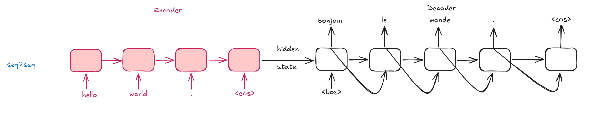

编码器是一个RNN（没有输出），读取输入句子，可以是双向RNN（特征提取）。其最后时间步的隐状态用作解码器的初始隐状态。

解码器使用另外一个RNN来输出。

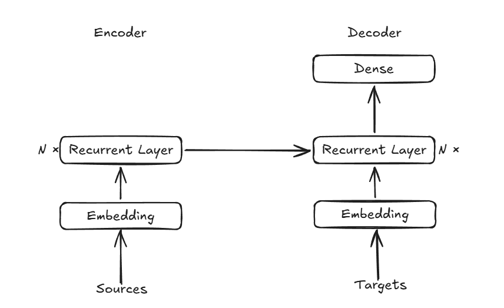

关于训推：

训练时解码器使用目标句子作为输入：

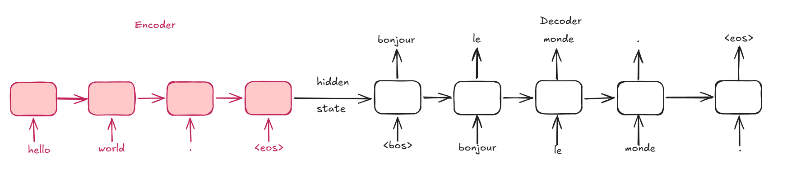

推理时为自回归：

衡量指标--衡量生成序列的好坏的BLEU：

假设 $P_n$ 是预测中所有n-gram的精度，BLEU的定义为：

$$
BLEU = exp(min(0,1-\frac{len_{label}}{len_{pred}}))\prod_{n=1}^{k}p_n^{1/2^n}
$$

核心思想是：惩罚**相较于翻译的参考答案**过短的预测、长匹配有更高权重。

#### 实验28：seq2seq的实现
>
>`code/nlp/seq2seq.py`

然而，在生成序列时，每一步都选当前概率最大的词（贪心），最终得到的整条序列的概率，可能并不是全局最优的。

table 1:

| Time step | 1 | 2 | 3 | 4 |
| :---: | :---: | :---: | :---: | :---: |
| A | **0.5** | 0.1 | 0.2 | 0.0 |
| B | 0.2 | **0.4** | 0.2 | 0.2 |
| C | 0.2 | 0.3 | **0.4** | 0.2 |
| `<eos>` | 0.1 | 0.2 | 0.2 | **0.6** |

table 2:

| Time step | 1 | 2 | 3 | 4 |
| :---: | :---: | :---: | :---: | :---: |
| A | **0.5** | 0.1 | 0.1 | 0.1 |
| B | 0.2 | 0.4 | **0.6** | 0.2 |
| C | 0.2 | **0.3** | 0.2 | 0.2 |
| `<eos>` | 0.1 | 0.2 | 0.1 | **0.6** |

比如是贪心策略table1：

- Time step 1：A概率0.5最大，选A。

- Time step 2：基于A，B概率0.4最大，选B。

- Time step 3：基于A和B，C概率0.4最大，选C。

- Time step 4：基于A、B、C，`<eos>`概率0.6最大，选`<eos>`。

最终路径：A -> B -> C -> `<eos>`

整条序列的联合概率：0.5 × 0.4 × 0.4 × 0.6 = 0.048

table2展示了另一条路径，它在第二步没有选当前最大的概率：

- Time step 1：依然选A (0.5)。

- Time step 2：虽然B的概率(0.4)比C(0.3)大，但如果我们选C (0.3)。

- Time step 3：由于前面的选择是A和C，此时B的概率飙升到了0.6（比贪心路径里的0.4高很多），选B。

- Time step 4：选`<eos>`，概率为0.6。

最终路径：A -> C -> B -> `<eos>`

整条序列的联合概率：0.5 × 0.3 × 0.6 × 0.6 = 0.054 > 0.048

可见贪心不等于最优。

为了找到最优，假如用穷举搜索，最优算法即为：对所有可能的序列，计算它的概率，然后选取最好的那个。

如果输出字典大小为n,序列最长为T，那么我们需要考察 $n^T$ 个序列，

比如n=10000，T=10，则

$n^T=10^{40}$

这在计算上是不可行的。

于是有束搜索 Beam Search：

- 保存最好的k个候选
- 在每个时刻，对每个候选新加一项（n种可能），在kn个选项中选出最好的k个。

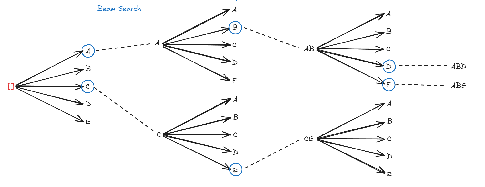

时间复杂度为O(knT)。比如k=5,n=10000,T=10,则knT=5e5。

每个候选的最终分数是：

$$
\frac{1}{L^{\alpha}}log p(y_1,...,y_L) = \frac{1}{L^{\alpha}}\sum_{t'=1}^{L}logp(y_{t'}|y_1,....,y_{t'-1})
$$

通常α取0.75。

当k=1,beam search等价于贪心搜索；k=n，beam search也不是穷举搜索；k=C,C只要是固定常数，就一定不是穷举搜索。

## 十五、注意力机制

动物需要在复杂环境下有效关注值得注意的点。心理学框架认为人类根据随意线索和不随意线索选择注意点。

卷积、全连接、池化层都只考虑不随意线索。注意力机制则显式地考虑随意线索。

随意线索被称之为查询query。

每个输入是不随意线索key和一个值value的对。通过注意力池化层来有偏向性地选择某些输入。

注意力在统计历史上早有来源：

非参注意力池化层：

给定数据

$$
(x_i,y_i),i=1,...,n
$$

平均池化是最简单的方案：

$$
f(x) = \frac{1}{n}\sum_i y_i
$$

更好的方案是60年代提出来的Nadaraya-Watson核回归：

$$
f(x) = \sum_{i=1}^{n}\frac{K(x-x_i)}{\sum_{j=1}^{n}K(x-x_j)}y_i \\
\text{where the Query is }x\\
\text{ the Key is }x_i\\
\text{ the Value is }y_i\\
\text{ the Attention Weights is }\frac{K(x-x_i)}{\sum_{j=1}^{n}K(x-x_j)}\\
\text{ the Output is }f(x)\\
$$

使用高斯核：

$$
K(u) = \frac{1}{\sqrt{2\pi}}exp(-\frac{u^2}{2})
$$

那么

$$
f(x) = \sum_{i=1}^{n}\frac{exp(-\frac{1}{2}(x-x_i)^2)}{\sum_{j=1}^{n}exp(-\frac{1}{2}(x-x_j)^2)}y_i \\
= \sum_{i=1}^nsoftmax(-\frac{1}{2}(x-x_i)^2)y_i
$$

加上可以学习的参数w，则参数化的注意力机制：

$$
f(x) = \sum_{i=1}^nsoftmax(-\frac{1}{2}((x-x_i)w)^2)y_i
$$

注意力机制中，通过query(随机线索)和key(不随意线索)来有偏向性的选择输入。可一般写作：

$$
f(x) = \sum_i \alpha(x,x_i)y_i \\
\text{where }\alpha(x,x_i)\text{ is the attention weight} 
$$

#### 实验29：无参注意力机制的实现
>
>`code/nlp/nadaraya_watson.py`

扩展到高维度，假设

$$
\text{one query }q ∈ R^q \\
\text{m对 } key-value (k_1,v_1),(k_2,v_2),...,(k_m,v_m) \\
k_i ∈ R^k,v_i ∈ R^v
$$

则注意力池化层为：

$$
f(q,(k_1,v_1),...,(k_m,v_m)) = \sum_{i=1}^{m}\alpha(q,k_i)v_i ∈ R^v
\\
\alpha(q,k_i) = softmax(a(q,k_i)) ∈ R
$$

我们注意到可以改动的就是attention score部分（query和key的相似度）：

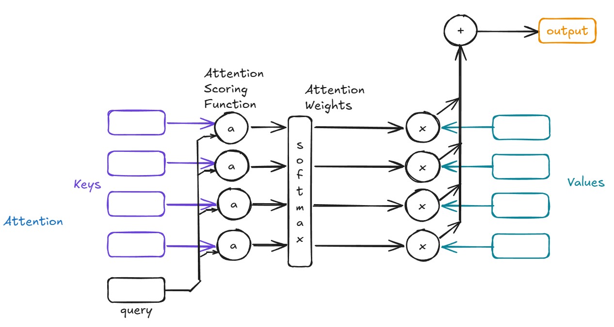

常见的attention score function就是：

1.Additive Attention:

可学参数：

$$
W_k ∈ R^{h×k},W_q ∈ R^{h×q},v ∈ R^h
\\
a(k,q) = v^T tanh(W_kk+w_qq) 
$$

等价于将key和value合并起来后放入到一个隐藏大小为h，输出大小为1的单隐藏层MLP。

2.Scaled Dot-Product Attention

如果query和key都是同样的长度：

$$
q,k_i ∈ R^d
$$

那么：

$$
a(q,k_i) = <q,k_i>/\sqrt{d}
$$

上升到一般的向量化Attention表示：

$$
Q ∈ R^{n×d},K ∈ R^{m×d}, ∈ R^{m×v}
\\
a(Q,K) = QK^T/\sqrt{d} ∈ R^{n×m}
\\
f = softmax(a(Q,K))V ∈ R^{n×v}
$$

#### 实验30：两种Attention Score Function的实现
>
>`code/nlp/attention_score.py`

注意力机制在seq2seq的应用：

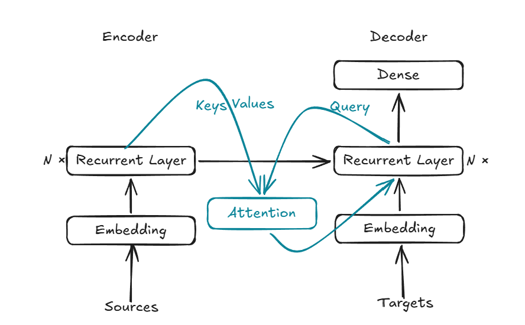

编码器对每次词的输出作为key和value(它们相同)，解码器RNN对上一个词的输出是query（最开始没输出的时候用解码器最后一层的以后一步的输出），注意力的输出和下一个词的词嵌入合并进入RNN。注意力机制可以根据解码器RNN的输出来匹配到合适的编码器RNN的输出来更有效地传递信息。

#### 实验31：注意力机制在seq2seq的应用
>
>`code/nlp/bahdanau_attention.py`

下面讲解自注意力。

给定序列 $x_1,...,x_n$ ，任意 $x_i∈R^d$ ，自注意力池化层将 $x_i$ 当做key, value，query来对序列抽取特征得到 $y_1,...,y_n$ ，这里

$$
y_i = f(x_i,(x_1,x_1),...,(x_n,x_n)) ∈ R^d
$$

| | CNN | RNN | 自注意力 |
| :--- | :---: | :---: | :---: |
| **计算复杂度** | $O(knd^2)$ | $O(nd^2)$ | $O(n^2d)$ |
| **并行度** | $O(n)$ | $O(1)$ | $O(n)$ |
| **最长路径** | $O(n/k)$ | $O(n)$ | $O(1)$ |
| **长距离依赖** | 需堆叠层数 | 严重遗忘 | 完美捕捉 |

跟CNN/RNN不同，自注意力并没有记录位置信息。

位置编码将位置信息注入到输入里。假设长度为n的序列是：

$$
X ∈ R^{n×d}
$$

那么使用位置编码矩阵

$$
P ∈ R^{n×d}
$$

来输出 **X** + **P** 作为自编码输入。

**P**的元素如下计算：

$$
P_{i,2j} = sin(\frac{i}{10000^{2j/d}})
\\
P_{i,2j+1} = cos(\frac{i}{10000^{2j/d}})
$$

## 十六、Transformer

和使用注意力的seq2seq不同，Transformer是纯基于注意力。

多头注意力(对统一key,value,query,希望抽取不同的信息)：

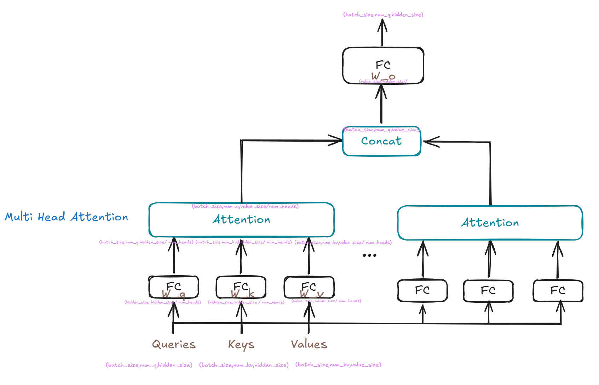

多头注意力使用h个独立的注意力池化，合并各个头输出得到最终输出。

#### 实验32：多头注意力的实现
>
>`code/nlp/multi_head_attention.py`

Layer Normalization：

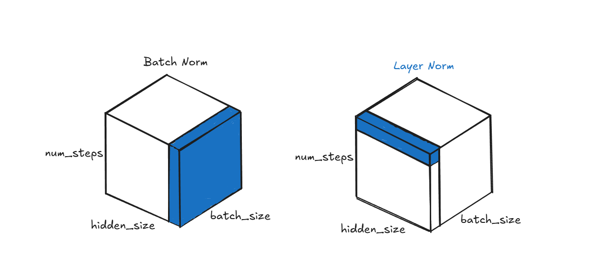

transformer:

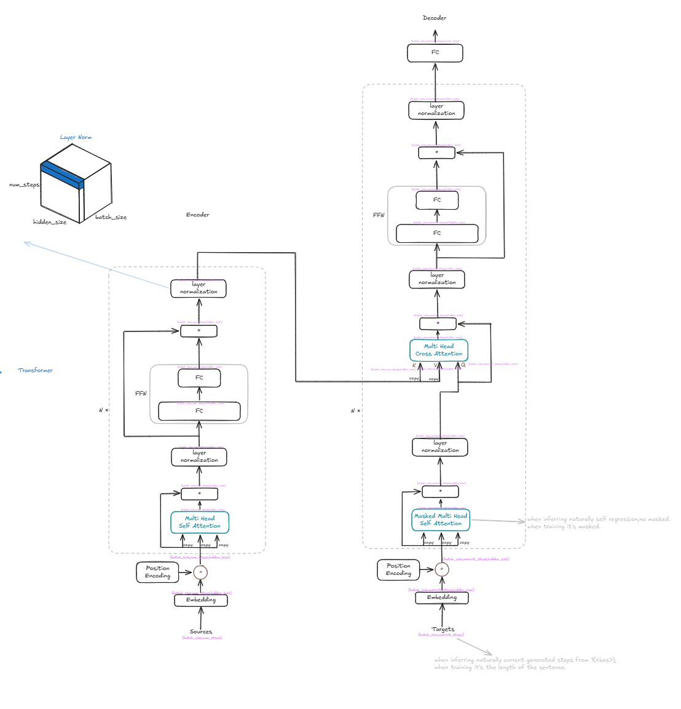

#### 实验33：transformer的实现
>
>`code/nlp/transformer.py`

