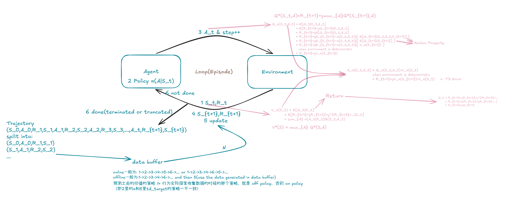
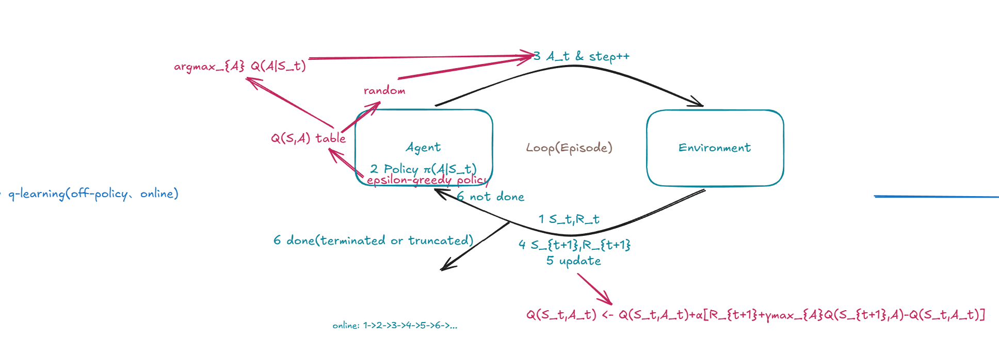
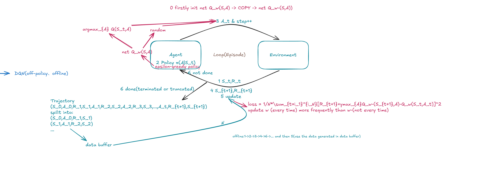
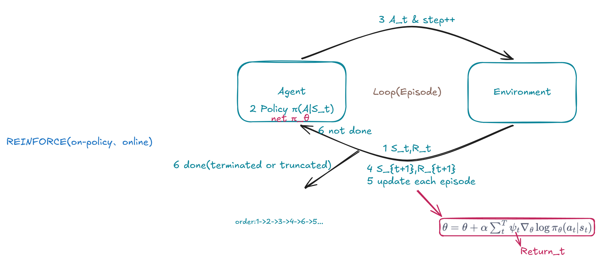
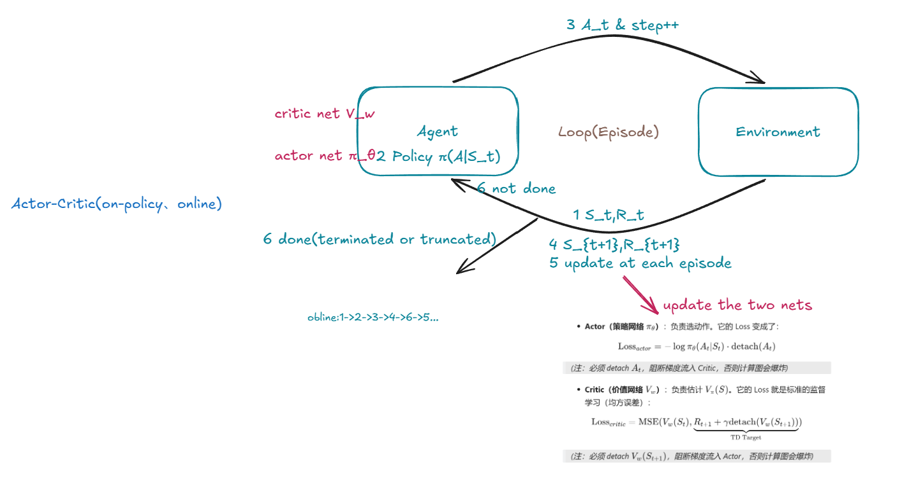
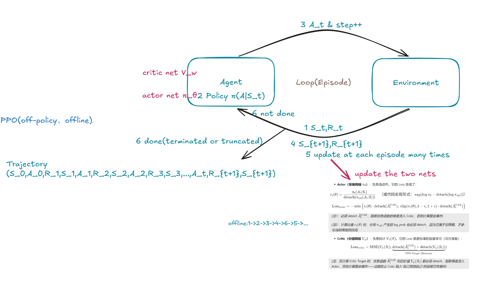

# reinforcement learning notes

这本书是我的强化学习笔记，从2026年10月9日开始，我结束了保研，是刚大四的状态。

强化学习和强化学习一样，改变了世界，我会把强化学习放在当前智能的上限的最后一公里的位置上，Yann LeCun 在 NIPS 2016 大会上提出了他如今已是家喻户晓的“蛋糕比喻”：“如果智能是一个蛋糕，那么蛋糕的主体是无监督学习，蛋糕上的糖霜是监督学习，而蛋糕顶部的樱桃则是强化学习 (RL)。

于是我想在正式成为一名严格意义上的研究生之前，把强化学习的基础打扎实了，系统地学一遍。

我们这本书数学基础和代码并重。

本书适合有一定机器学习、深度学习和强化学习基础，且对python语法比较熟悉，但是又没有系统地学习和整理强化学习知识的读者。希望这本书对各大读者有帮助，欢迎各位提交PR、和我沟通等。

- 我的邮箱: zhouhy5523@gmail.com

为了方便起见，本书大写字母符号都代表矩阵，小写字母符号代表标量。

## 一、基础概念



Agent、Environment、State、Reward、Policy、Action、Done(terminated or truncated)、Episode、Trajectory、Return、StateValue、ActionValue、Advantage、TDError、Markov Property、data buffer、online algorithm、offline algorithm、on policy algorithm、off policy algorithm、Optimal State Value Function、Optimal Action Value Function.

## 二、q-learning



q-learning为什么有效的理论推导：

有贝尔曼最优方程：

$$
Q^*(S_t,A)=R_{t+1}+γmax_{A}Q^*(S_{t+1},A)
$$

带α的q-learning更新公式：

$$
Q_{t+1}(S_t,A_t) = Q_t(S_t,A_t)+α[R_{t+1}+γmax_{A}Q_t(S_{t+1},A)-Q_t(S_t,A_t)]
\\
= (1-\alpha)Q_t+\alpha[R_{t+1}+\gamma maxQ_t(S_{t+1})]
$$

定义误差：

$$
e_t = Q_t - Q^*
$$

我们的目标是看 $e_{t+1}$ 和 $e_t$ 的关系。

等式两边同时减去Q*：

$$
Q_{t+1}-Q^* = (1-\alpha)Q_t+\alpha[R_{t+1}+\gamma maxQ_t(S_{t+1})] - Q^*
\\
= (1-\alpha)(Q_t-Q^*)+\alpha[R_{t+1}+\gamma maxQ_t(S_{t+1})-Q^*]
$$

带入贝尔曼最优方程：

$$
e_{t+1} = (1-\alpha)e_t + \alpha[R_{t+1}+\gamma maxQ_t(S_{t+1})-(R_{t+1}+\gamma maxQ^*(S_{t+1}))]
\\
e_{t+1} = (1-\alpha)e_t+\alpha\gamma[maxQ_t(S_{t+1})-maxQ^*(S_{t+1})]
$$

由于

$$
|maxQ_t - maxQ^*| ≤ max|Q_t - Q^*| = |e_t|
$$

再由三角不等式，有：

$$
|e_{t+1}| ≤ (1-\alpha)|e_t| + \alpha\gamma |e_t| 
$$

即为：

$$
|e_{t+1}| ≤ (1-\alpha + \alpha\gamma )|e_t| 
$$

由于

$$
\alpha ∈ (0,1],\gamma ∈ [0,1)
$$

则

$$
(1-\alpha+\alpha\gamma) < 1
$$

即：误差经过q-learning更新公式的迭代变小了。最终Q Table会收敛到最优动作价值。

#### 实验34：q-learning的实现
>
>`code/q_learning/q_learning.py`

## 三、DQN



#### 实验35：DQN 的实现
>
>`code/q_learning/dqn.py`

## 四、REINFORCE

基于价值的强化学习算法流派先告一段落，我们进入基于策略的强化学习算法流派的学习。



我们的目标：最大化期望回报 

$$
J(\theta) = \mathbb{E}_{\pi_\theta}[G_t]
$$

也就是要算

$$
∇_θJ(θ)
$$

期望的展开式是：
$$
J(\theta) = \sum_{\tau} P(\tau|\theta) G(\tau) 
$$

这里 $P(\tau|\theta)$ 是这条轨迹发生的概率，它由三部分相乘构成：

$$
P(\tau|\theta) = \underbrace{\rho_0(S_0)}_{\text{初始状态概率}} \cdot \prod_{t=0}^{T} \underbrace{P(S_{t+1}|S_t, A_t)}_{\text{环境状态转移概率}} \cdot \prod_{t=0}^{T} \underbrace{\pi_\theta(A_t|S_t)}_{\text{策略网络概率}} 
$$

我们要求 $\nabla_\theta{}J(\theta)$ ：

$$
\nabla_\theta J(\theta) = \nabla_\theta \sum_{\tau} P(\tau|\theta) G(\tau) = \sum_{\tau} \nabla_\theta P(\tau|\theta) G(\tau) 
$$

我们引入一个纯代数恒等式：

$$
\nabla_\theta P = P \cdot \nabla_\theta \log P
$$

把这个恒等式代入：

$$
 \nabla_\theta J(\theta) = \sum_{\tau} P(\tau|\theta) \cdot \nabla_\theta \log P(\tau|\theta) \cdot G(\tau) 
$$

写成期望形式就是：

$$
 \nabla_\theta J(\theta) = \mathbb{E}_{\tau \sim P(\cdot|\theta)} [ \nabla_\theta \log P(\tau|\theta) \cdot G(\tau) ] 
$$

我们对刚才那个长长的 $P(\tau|\theta)$ 取 $log$ （连乘变连加）：

$$
\log P(\tau|\theta) = \log \rho_0(S_0) + \sum_{t=0}^{T} \log P(S_{t+1}|S_t, A_t) + \sum_{t=0}^{T} \log \pi_\theta(A_t|S_t) 
$$

现在，对 $\theta$ 求梯度 $\nabla_\theta$ ：

$$
\nabla_\theta \log \rho_0(S_0) = 0
$$

$$
\nabla_\theta \log P(S_{t+1}|S_t, A_t) = 0
$$

（**环境状态转移概率（比如物理规律）不由网络参数决定**）

只剩下策略部分：

$$
\nabla_\theta \log \pi_\theta(A_t|S_t)
$$

所以

$$
\nabla_\theta \log P(\tau|\theta) = \sum_{t=0}^{T} \nabla_\theta \log \pi_\theta(A_t|S_t)
$$

把该结果代回期望：

$$
\nabla_\theta J(\theta) = \mathbb{E}_{\tau} \left[ \left( \sum_{t=0}^{T} \nabla_\theta \log \pi_\theta(A_t|S_t) \right) \cdot G(\tau) \right] 
$$

因为 t 时刻的动作无法影响 t 时刻之前的奖励（因果律），所以交叉项期望为0。最终只剩下各自时间步的对应关系：

$$
\nabla_\theta J(\theta) = \mathbb{E}_{\pi_\theta} [ \sum_{t=0}^T\nabla_\theta \log \pi_\theta(A_t|S_t) \cdot G_t ] 
$$

下标的替换是因为：策略 $\pi_\theta$ 是决定轨迹分布 $P(\tau|\theta)$ 中唯一包含参数 $\theta$  的部分（环境转移 $P(S'|S,A)$ 和初始状态 $\rho_0$ 都不依赖 $\theta$ ）。所以，对轨迹分布求期望 $\mathbb{E}_{\tau{}\sim{}P(\cdot|\theta)}[\dots]$ ，在数学上就完全等价于对策略 $\pi_\theta$ 求期望 $\mathbb{E}_{\pi_\theta}[\dots]$ 。这两个符号指代的是同一个东西。

我们不需要、也没法推出 J 本身。回到J的定义，其对所有可能的轨迹 τ 求和，轨迹的数量那就多了去了， J(θ) 的解析表达式是永远写不出来的。它在坐标系里是一个无穷维的怪物。J的梯度同理。但是我们可以跑一条轨迹，用单次采样（蒙特卡洛）来近似！

我们用跑一条轨迹（蒙特卡洛采样）算出来的值，去估计（估算）真实的梯度：

$$
\nabla_\theta J(\theta) ≈  \sum_{t=0}^T\nabla_\theta \log \pi_\theta(A_t|S_t) \cdot G_t
$$

由此可以反推出Loss(求J的最大值，等价于求-J的最小值):

$$
\text{Loss} = - \sum_{t=0}^T \log \pi_\theta(A_t|S_t) \cdot G_t 
$$

更新公式为：

$$
\theta = \theta + \alpha  \sum_{t=0}^T\nabla_\theta \log \pi_\theta(A_t|S_t) \cdot G_t
$$

#### 实验36：REINFORCE 的实现
>
>`code/reinforce/reinforce.py`

## 五、Actor-Critic

REINFORCE 的代数缺陷是什么？

REINFORCE的更新公式是：

$$
\text{Loss} = - \log \pi_\theta(A_t|S_t) \cdot G_t 
$$

这里的 $G_t$ 是一条完整轨迹跑出来的真实回报（蒙特卡洛）。

-   **高方差**：如果这一步动作是对的，但后面运气不好拿了负分， $G_t$ 是负的，你的网络就会惩罚这个“正确”的动作。
-   **必须跑完一局**：必须跑到 `done=True` 才能算出 $G_t$ 去更新。
-   **Online 死板**：数据用完即扔，太浪费。

AC 真正弥补的，是 REINFORCE 的高方差（High Variance）和必须跑完一整个 Episode 才能更新这两个代数缺陷。



我们之前在第一节推导过一个绝佳的替代品——**优势函数** $A_t$ ：

$$
A_\pi(S_t, A_t) = Q_\pi(S_t, A_t) - V_\pi(S_t) 
$$

在确定性环境下，它可以写成 TD Error 的形式：

$$
A_\pi(S_t, A_t) \approx R_{t+1} + \gamma V_\pi(S_{t+1}) - V_\pi(S_t) 
$$

$A_t$ 的物理意义是：“当前动作比平均水平 $V$ 好多少”。它比 $G_t$ 的方差小得多。

既然 $G_t$ 换成了 $A_t$ ，我们就需要两个网络：

- **Actor（策略网络 $\pi_\theta$ ）**：负责选动作。它的 Loss 变成了：

$$
\text{Loss}_{actor} = - \log \pi_\theta(A_t|S_t) \cdot \text{detach}(A_t) 
$$

>*(注：必须 detach $A_t$ ，阻断梯度流入 Critic，否则计算图会爆炸)*

- **Critic（价值网络 $V_w$ ）**：负责估计 $V_\pi(S)$ 。它的 Loss 就是标准的监督学习（均方误差）：

$$
\text{Loss}_{critic} = \text{MSE}(V_w(S_t), \underbrace{R_{t+1} + \gamma \text{detach}(V_w(S_{t+1}))}_{\text{TD Target}}) 
$$

>*(注：必须 detach $V_w(S_{t+1})$ ，阻断梯度流入 Actor，否则计算图会爆炸)*

#### 实验37：Actor-Critic 的实现
>
>`code/actor_critic/actor_critic.py`

## 六、PPO

Actor-Critic 的痛点：

Actor-Critic 是 Online 的，跑完一局，立刻更新，用完就扔。这太浪费了！

能不能让这条轨迹的数据，多更新几次？

**不行。** 因为只要你的策略 $\pi_\theta$ 更新了一点点，这条轨迹的数据分布就“过期”了，在数学上 $\mathbb{E}_{\pi_\theta}$ 就不再服从旧的数据分布，强行用会算错梯度。

**PPO 的补丁：Importance Sampling + Clip**:



PPO 解决这个问题的纯代数方式极其暴力：
- **第一步（Importance Sampling）**：在更新时，乘以一个比值 $r_t(\theta){}={}\frac{\pi_\theta(a_t|s_t)}{\pi_{old}(a_t|s_t)}$ 。这个比值相当于在数学上“强行纠正”过期数据的分布偏差。这样，你就能用旧数据 $\pi_{old}$ 跑出来的轨迹，反复更新当前的 $\pi_\theta$ 。
- **第二步（Clip）**：但比值 $r_t$ 不能太大，否则梯度会爆炸。所以 PPO 加了一个强制约束：

$$
 \text{Actor Loss} = - \min \left( r_t(\theta) A_t, \text{clip}(r_t(\theta), 1-\epsilon, 1+\epsilon) A_t \right) 
$$

>（如果新策略和旧策略差得太远，Clip 机制就会把梯度切断，强迫它们“别离得太远”）。

**这里推导一下Actor Loss：**

首先，为什么 AC 的 Loss 里有 $\log{}\pi_\theta$ ？

因为我们要最大化目标 $J(\theta)$ ，对策略参数 $\theta$ 求梯度后，根据策略梯度定理，得到：
$$
 \nabla_\theta J(\theta) = \mathbb{E}[\nabla_\theta \log \pi_\theta(A_t|S_t) \cdot A_t] 
$$
为了让 PyTorch 自动求导引擎能算出这个梯度，我们在代码里拼凑了一个 Loss：
$$
 \text{Loss}_{actor} = - \log \pi_\theta(A_t|S_t) \cdot \text{detach}(A_t) 
$$
当 PyTorch 执行 `loss.backward()` 时，它会对 $\log{}\pi_\theta$ 求导，刚好得到 $\nabla_\theta{}\log{}\pi_\theta$ ，完美对应数学目标。

那 PPO 是怎么把 $\log{}\pi_\theta$ “藏起来”的？

PPO 为了能用旧策略 $\pi_{old}$ 的数据，引入了重要性采样比值：

$$
 r_t(\theta) = \frac{\pi_\theta(A_t|S_t)}{\pi_{old}(A_t|S_t)} 
$$

我们对 $r_t(\theta)$ 取对数：

$$
 \log r_t(\theta) = \log \pi_\theta - \log \pi_{old} 
$$

现在，我们对 $\theta$ 求梯度（注意， $\pi_{old}$ 是旧策略，里面**没有 $\theta$**，所以它是常数）：

$$
 \nabla_\theta \log r_t(\theta) = \nabla_\theta \log \pi_\theta - 0 = \nabla_\theta \log \pi_\theta 
$$

（看！ $\log{}\pi_\theta$ 的梯度，就是 $r_t(\theta)$ 的对数梯度。）

利用初中代数的链式法则（ $\nabla{}f{}={}f{}\cdot{}\nabla{}\log{}f$ ），我们可以推出一个极其漂亮的等式：

$$
 \nabla_\theta r_t(\theta) = r_t(\theta) \cdot \nabla_\theta \log r_t(\theta) = r_t(\theta) \cdot \nabla_\theta \log \pi_\theta 
$$

现在，把这个等式代入 PPO 的数学目标里。
PPO 原本要最大化的目标梯度是：

$$
 \mathbb{E} \left[ \frac{\pi_\theta}{\pi_{old}} \nabla_\theta \log \pi_\theta \cdot A_t \right] 
$$

把 $\frac{\pi_\theta}{\pi_{old}}$ 替换成 $r_t(\theta)$ ：

$$
 \mathbb{E} \left[ r_t(\theta) \nabla_\theta \log \pi_\theta \cdot A_t \right] 
$$

把上面推导的等式代进去（ $r_t(\theta){}\nabla_\theta{}\log{}\pi_\theta{}={}\nabla_\theta{}r_t(\theta)$ ）：

$$
 \mathbb{E} \left[ \nabla_\theta r_t(\theta) \cdot A_t \right] 
$$

反推 Loss，因为我们在数学上要算的梯度变成了 $\mathbb{E}[\nabla_\theta{}r_t(\theta){}\cdot{}A_t]$ ，所以我们只需要在代码里拼凑出这样的 Loss：

$$
 \text{Loss}_{actor} = - r_t(\theta) \cdot \text{detach}(A_t) 
$$

这就是看到的 PPO Loss 里没有 $\log{}\pi_\theta$ 的原因。

为了防止 $r_t(\theta)$ 太大（策略更新步子太猛），PPO 在 Loss 外面套了一个 `min` 和 `clip`：
$$
 \text{Actor Loss} = - \min \left( r_t(\theta) A_t, \text{clip}(r_t(\theta), 1-\epsilon, 1+\epsilon) A_t \right) 
$$

**这里推导一下Critic Loss：**

Critic（价值网络 $V_w$ ）的唯一使命是尽可能准确地拟合真实的 $V^\pi(S_t)$ 。它的 Loss 是标准的监督学习（均方误差）：

$$ \text{Loss}_{critic} = \text{MSE}(V_w(S_t), \text{Target}) $$

在 PPO 中，这个 $\text{Target}$ 到底怎么算？

回忆优势函数的代数定义：

$$ A_t = Q_t - V_t $$

移项可得：

$$ Q_t = V_t + A_t $$

在 PPO 中，我们把这里的 $V_t$ 替换为**更新前的旧价值网络** $V_{old}(S_t)$ ，把 $A_t$ 替换为**广义优势估计** $\hat{A}_t^{GAE}$ 。于是，PPO 的 Critic Target 定义为：

$$ \text{Target}_{PPO} = V_{old}(S_t) + \hat{A}_t^{GAE} $$

我们算优势 $A_t$ 有两种极端做法：
- **极端一（高方差，无偏）**：蒙特卡洛（REINFORCE）。 $A_t{}={}G_t{}-{}V(S_t)$ 。依靠完整的真实回报 $G_t$ ，随机性大。
- **极端二（低方差，有偏）**：单步 TD Error（Actor-Critic）。 $A_t{}={}R_{t+1}{}+{}\gamma{}V(S_{t+1}){}-{}V(S_t)$ 。依靠下一状态的估计，平稳但存在偏差。

**GAE(广义优势估计) 的本质就是通过引入系数 $\lambda{}\in{}[0,1]$ ，在两者之间做平滑的代数插值。**

首先定义单步 TD Error：

$$ \delta_t = R_{t+1} + \gamma V(S_{t+1}) - V(S_t) $$

GAE 的定义是将当前步和未来所有步的 $\delta$ 加权求和，权重为 $(\gamma{}\lambda)^l$ ：

$$ \hat{A}_t^{GAE} = \sum_{l=0}^{\infty} (\gamma \lambda)^l \delta_{t+l} = \delta_t + (\gamma \lambda) \delta_{t+1} + (\gamma \lambda)^2 \delta_{t+2} + \dots $$

**极限验证（纯代数展开）：**
- **当 $\lambda{}={}0$ 时**： $\hat{A}_t^{GAE}{}={}\delta_t$ ，退化为单步 AC 的优势。
- **当 $\lambda{}={}1$ 时**：展开式子，中间的 $V$ 项会互相抵消（多米诺骨牌），最终得 $\hat{A}_t^{GAE}{}={}G_t{}-{}V_t$ ，退化为 REINFORCE 的蒙特卡洛优势。

GAE的工程实现--倒序计算与 Target 合并：在代码里，不可能去算无穷级数，利用递推关系：

$$ \hat{A}_t^{GAE} = \delta_t + \gamma \lambda \hat{A}_{t+1}^{GAE} $$

这完美对应了代码里的**倒序循环**：

```python
# 倒序计算，从最后一步往前推
gae = 0
for t in reversed(range(T)):
    # 算单步 TD Error
    delta = rewards[t] + gamma * next_values[t] * (1 - dones[t]) - values[t]
    # 递推累加 GAE
    gae = delta + gamma * lambda_ * gae
    advantages[t] = gae
```

当把 $\hat{A}_t^{GAE}$ 代回 Target 公式时，我们来看看它的本质：
如果 $\lambda=1$ ，代入后 $V_{old}$ 抵消：

$$ \text{Target} = V_{old}(S_t) + (G_t - V_{old}(S_t)) = G_t $$

在实际 PPO 里 $\lambda$ 通常取 0.95，这个 Target 就是“被 $V$ 估计平滑过的多步回报”，完美平衡了偏差与方差。

综上，得：

- **Actor（策略网络 $\pi_\theta$ ）**：负责选动作。它的 Loss 变成了：

$$
r_t(\theta) = \frac{\pi_\theta(A_t|S_t)}{\text{detach}(\pi_{old}(A_t|S_t))} \quad \text{（或代码实现形式：} \exp(\log \pi_\theta - \text{detach}(\log \pi_{old})) \text{）}
$$

$$
\text{Loss}_{actor} = - \min \left( r_t(\theta) \cdot \text{detach}(\hat{A}_t^{GAE}), \ \text{clip}(r_t(\theta), 1-\epsilon, 1+\epsilon) \cdot \text{detach}(\hat{A}_t^{GAE}) \right)
$$

>*(注1：必须 detach $\hat{A}_t^{GAE}$ ，阻断优势函数的梯度流入 Critic，否则计算图会爆炸)*
>
>*(注2：计算比值 $r_t(\theta)$ 时，分母 $\pi_{old}$ 产生的 log_prob 也必须 detach，因为它属于旧策略，不参与当前梯度的回流)*

- **Critic（价值网络 $V_w$ ）**：负责估计 $V_\pi(S)$ 。它的 Loss 就是标准的监督学习（均方误差）：

$$
\text{Loss}_{critic} = \text{MSE}(V_w(S_t), \underbrace{\text{detach}(\hat{A}_t^{GAE}) + \text{detach}(V_w(S_t))}_{\text{PPO Target (Returns)}}) 
$$

>*(注：在计算 Critic Target 时，优势函数 $\hat{A}_t^{GAE}$ 和旧价值 $V_w(S_t)$ 都必须 detach，阻断梯度流入 Actor，否则计算图会爆炸——这能防止 Critic 陷入“自己预测自己”的追尾巴死循环)*

#### 实验38：PPO 的实现
>
>`code/actor_critic/ppo.py`